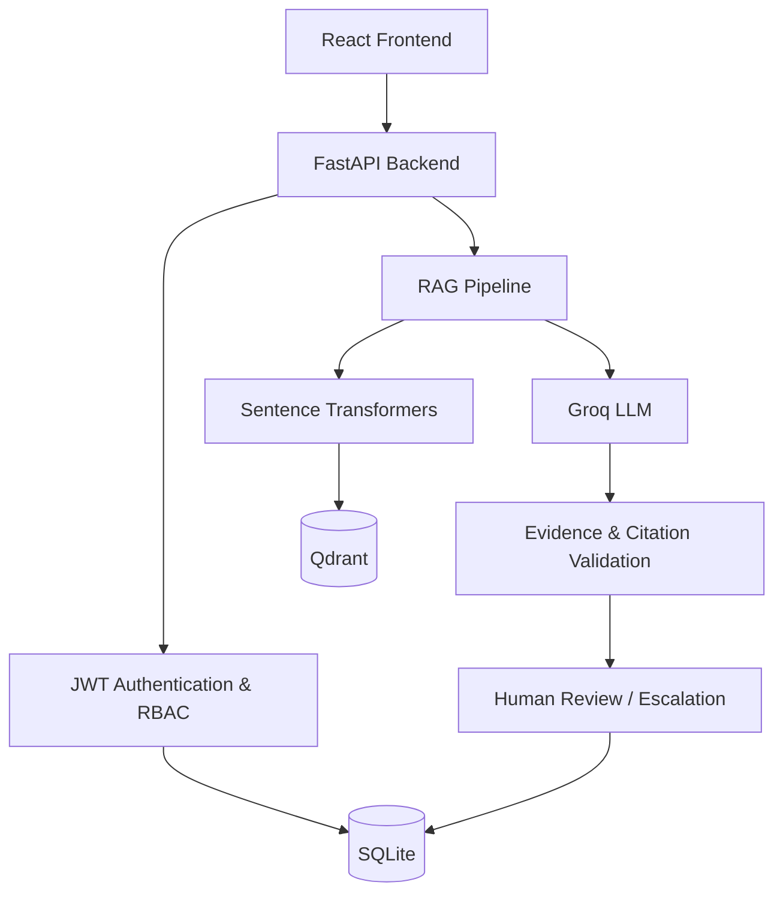

# ResolveAI — AI-Powered Support Ticket Resolution Copilot

ResolveAI is a full-stack AI-powered support operations platform that helps support teams manage tickets, retrieve knowledge-base evidence, generate grounded resolutions, and review AI-generated responses through human approval workflows.

## Key Features

### Ticket Management
- Create, list, search, filter and manage support tickets.
- Track ticket status, priority and category.
- Maintain ticket history and internal notes.

### AI-Powered Resolution
- Groq-powered ticket classification and resolution generation.
- Evidence-grounded responses using RAG.
- Source citation validation against retrieved knowledge chunks.
- Confidence-based escalation and human review.
- Safe handling of unsupported AI claims.

### Knowledge Base & RAG
- Upload PDF, TXT and Markdown documents.
- Text extraction, chunking and embedding generation.
- Semantic retrieval using Sentence Transformers and Qdrant.
- Duplicate document detection.
- Six included support knowledge-base guides.

### Human-in-the-Loop Workflow
- Review AI-generated responses.
- Edit, approve or reject proposed responses.
- Maintain action history and authenticated agent attribution.
- Escalate low-confidence or unsupported responses.

### Authentication & Authorization
- JWT-based authentication.
- Argon2 password hashing.
- Admin, Agent and Viewer roles.
- Role-based API access control.
- Admin-only user management APIs.
- Protected customer information and internal notes.

### Analytics
- Ticket overview and trends.
- Category and priority distribution.
- SLA analytics.
- Approval and rejection analytics.
- Support activity metrics.

## Technology Stack

| Layer | Technologies |
|---|---|
| Frontend | React, Vite, Tailwind CSS |
| Backend | Python, FastAPI |
| Database | SQLite, SQLAlchemy |
| Vector Database | Qdrant |
| Embeddings | Sentence Transformers |
| LLM | Groq |
| Authentication | JWT, Argon2 |
| Testing | Pytest, HTTPX |

## Architecture



## Requirements

- Python 3.12.4
- Node.js 20+
- npm
- Groq API key for AI-powered operations

## Local Setup

### 1. Clone the repository

```bash
git clone YOUR_GITHUB_REPOSITORY_URL
cd ResolveAI
```

### 2. Backend setup

```powershell
cd backend

python -m venv .venv
.\.venv\Scripts\Activate.ps1

pip install -r requirements-dev.txt

Copy-Item .env.example .env
```

Configure the following values in `backend/.env`:

- `GROQ_API_KEY`
- `JWT_SECRET_KEY` — minimum 32 characters
- `ADMIN_EMAIL`
- `ADMIN_PASSWORD` — minimum 12 characters
- `ADMIN_FULL_NAME`

Never commit the actual `.env` file.

Start the backend:

```powershell
python -m uvicorn app.main:app --reload --port 8000
```

API documentation:

http://localhost:8000/docs

Health check:

http://localhost:8000/health

The initial Admin account is bootstrapped from environment variables during application startup.

### 3. Frontend setup

Open another terminal:

```powershell
cd frontend

npm install

Copy-Item .env.example .env

npm run dev
```

Open:

http://localhost:5173

Configure `VITE_API_URL` if the backend runs on a different address.

## Knowledge Base

The repository includes six Markdown guides:

- `password_and_login.md`
- `billing_and_payments.md`
- `invoices_and_verification.md`
- `refund_policy.md`
- `subscriptions_and_cancellation.md`
- `technical_troubleshooting.md`

An Admin can upload these through the Knowledge Base interface.

Documents are chunked, embedded and indexed in Qdrant.

## API Overview

| Area | Main endpoints |
|---|---|
| Authentication | `POST /api/auth/login` |
| Tickets | `/api/tickets` |
| Ticket history | `/api/tickets/{ticket_id}/history` |
| AI resolution | `/api/ai/analyze/{ticket_id}`, `/api/ai/resolve/{ticket_id}` |
| AI result | `/api/ai/result/{ticket_id}` |
| Knowledge base | `/api/knowledge/documents`, `/api/knowledge/upload`, `/api/knowledge/search` |
| Agent workflow | `/api/agents/escalated`, `/api/agents/{ticket_id}/approve`, `/reject`, `/edit-response` |
| Analytics | `/api/analytics/overview`, `/categories`, `/priorities`, `/trends`, `/sla`, `/approvals`, `/support-activity` |
| User management | `/api/users` |
| System health | `/health`, `/api/system/status` |

Protected endpoints require a JWT Bearer token. Access is controlled by user role.

Interactive API documentation is available at `/docs` during development.

## AI Safety & Grounding

- Uploaded documents are treated as untrusted reference material.
- AI responses are validated against retrieved evidence.
- Citations must correspond to retrieved document chunks.
- Low-confidence and unsupported responses require human review.
- Confidence is a heuristic, not a calibrated probability.
- AI-generated responses do not automatically imply human approval.

## Testing

Install development dependencies:

```powershell
cd backend
pip install -r requirements-dev.txt
```

Run the backend regression suite:

```powershell
python -m pytest -q
```

The latest verified backend regression result is **105 passed**.

Build the frontend:

```powershell
cd frontend
npm install
npm run build
```

## Deployment

### Backend — Render

The repository includes `render.yaml` for the backend Web Service configuration.

Production configuration includes:

- Python 3.12.4
- FastAPI/Uvicorn
- SQLite persistent storage
- Qdrant persistent storage
- Generated JWT secret
- Environment-based Admin bootstrap
- Groq API configuration
- Restricted CORS origins

Configure secret values in the Render Dashboard:

- `GROQ_API_KEY`
- `ADMIN_EMAIL`
- `ADMIN_PASSWORD`
- `CORS_ORIGINS`

The Render persistent disk is mounted under the backend data directory.

This deployment architecture is intended for a single-instance MVP. Multi-instance production deployments should use managed database and vector storage services.

### Frontend

The frontend can be deployed to Vercel or another static hosting provider.

Configure:

- `VITE_API_URL` — deployed backend URL.

Configure backend `CORS_ORIGINS` with the actual deployed frontend origin.

## Security Notes

- Never commit `.env` files or production credentials.
- Use strong Admin credentials.
- Keep JWT secrets private.
- Customer data and internal notes are role-restricted.
- Production deployment must use HTTPS.
- Configure request-body limits at the hosting/reverse-proxy layer.

## Project Status

Backend and frontend development builds have been verified locally. Live production deployment and final deployment QA are still pending.
